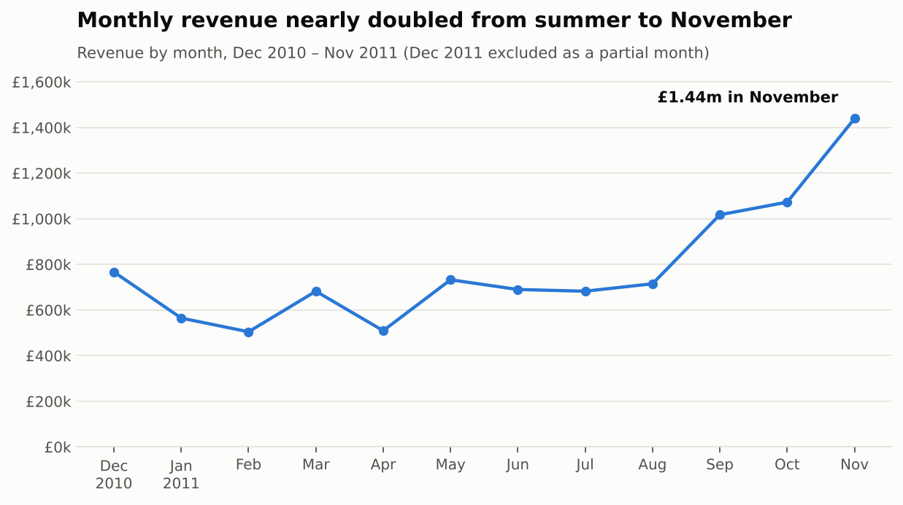
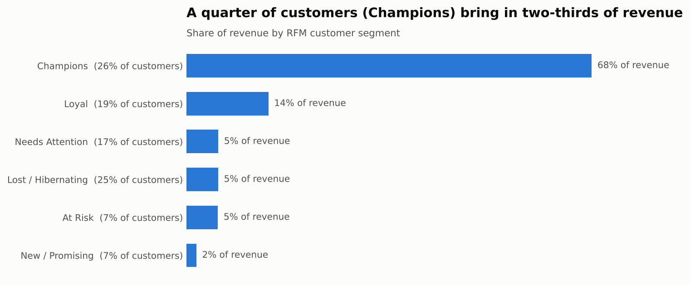
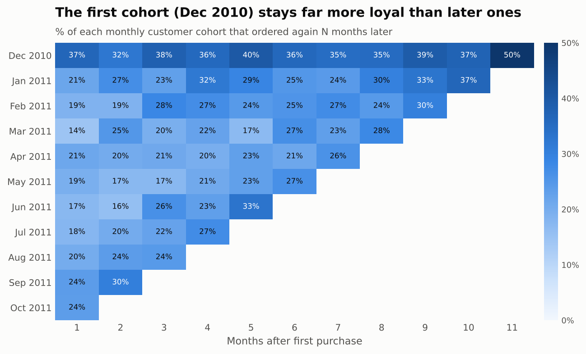
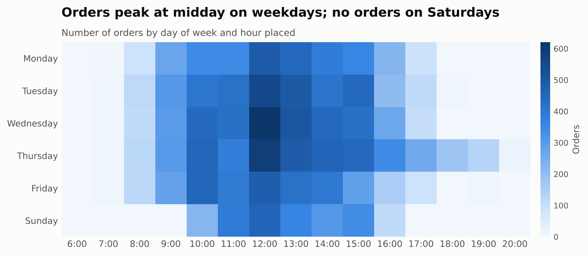

# 🛍️ UK Online Retail: Sales & Customer Analysis

[](https://github.com/sehan13/uk-online-retail-analysis/actions/workflows/tests.yml)

An end-to-end data analysis of **541,909 real transactions** from a UK-based online gift retailer (Dec 2010 – Dec 2011): data cleaning, KPIs, revenue trends, customer segmentation (RFM), cohort retention and SQL analysis, ending with business recommendations.

> Built with AI assistance (Claude). I reviewed, ran and checked the analysis and can explain each step.

**Tools:** Python (Pandas, Matplotlib), SQL (SQLite), Jupyter Notebook, unittest, GitHub Actions

📓 **[Read the full analysis notebook →](notebooks/analysis.ipynb)**

---

## Business questions
1. How is revenue trending, and is there seasonality?
2. Which markets and products drive revenue?
3. Who are the most valuable customers, and who is at risk of leaving?
4. How well does the business keep new customers?

## Key findings

| Metric | Value |
|---|---|
| Revenue (clean sales, Dec 2010 – Dec 2011) | **£9.82m** |
| Orders / customers / products | 19,648 / 4,324 / 3,902 |
| Average order value | **£500** |
| UK share of revenue | **85%** |
| Customers who ordered more than once | **65%**, bringing in **94% of revenue** |
| Share of invoices that were cancelled | 16% |

**1. Strong Q4 seasonality.** Revenue was flat at £0.5–0.75m a month, then rose to **£1.44m in November**. Sep–Nov averaged **1.8×** the Dec–Aug monthly level.



**2. A quarter of customers bring in two-thirds of revenue.** RFM segmentation shows **Champions (26% of customers) generate 68% of revenue**. 285 "At Risk" customers, who used to order often but haven't for 4–5 months, are the best target for a win-back campaign.



**3. Early retention is the biggest opportunity.** Only **about 21%** of new customers order again the next month, while the original Dec 2010 cohort stays at 32–50%.



**4. Buying behaviour looks business-to-business.** Orders peak 10:00–15:00 on weekdays, there are **no Saturday orders**, and some international buyers (Netherlands, Australia) average **£2,500+ per order**.



More charts: [top international markets](outputs/charts/top_international_markets.png) · [top products](outputs/charts/top_products.png)

## Recommendations
1. **Plan stock and staffing for Q4** from August.
2. **Protect the Champions** with account management, early access and loyalty pricing.
3. **Run a win-back campaign** for "At Risk" customers.
4. **Improve early repeat purchases** with a follow-up email series after the first order.
5. **Bundle products often bought together** (found with SQL basket analysis), such as matching Jumbo Bags and Regency teacups.
6. **Grow international trade accounts.** A few wholesale buyers abroad already spend £2,500+ per order.

## Data cleaning

Every rule is a separate, counted step ([full report](outputs/data_quality_report.md)):

| Step | Rows removed | Rows remaining |
|---|---:|---:|
| Raw rows loaded | 0 | 541,909 |
| Exact duplicate rows | 5,268 | 536,641 |
| Cancelled invoices (kept separately for analysis) | 9,251 | 527,390 |
| Zero or negative quantity | 1,336 | 526,054 |
| **Sales reversed by an exact-match cancellation** | 2,860 | 523,194 |
| Zero or negative unit price | 1,176 | 522,018 |
| Non-product codes (postage, fees, samples) | 2,286 | 519,732 |

The **reversed-sale** rule matters. Without it, two single orders of **80,995** and **74,215** units, both cancelled within minutes, would appear as the top-selling products. Rows with no CustomerID (25%) are kept for revenue analysis but excluded from customer analysis.

## SQL analysis

[`sql/queries.sql`](sql/queries.sql) answers business questions on the cleaned data in SQLite, using CTEs, window functions (`RANK() OVER`), `CASE`, self-joins and aggregation:
- monthly revenue and average order value
- top international markets
- repeat vs one-off customers' share of revenue
- revenue concentration in the top 10 customers
- busiest weekdays
- **products most often bought together** (basket analysis)

Results: [`outputs/sql_results.md`](outputs/sql_results.md). A test checks that the SQL and Pandas results match.

## Project structure

```
uk-online-retail-analysis/
├── data/online_retail.csv.gz      # raw data (UCI Online Retail)
├── src/
│   ├── clean.py                   # cleaning rules + data quality report
│   ├── analysis.py                # KPIs, trends, RFM, cohorts
│   ├── sql_analysis.py            # loads data into SQLite and runs the queries
│   └── charts.py                  # report charts
├── sql/queries.sql                # business questions in SQL
├── notebooks/analysis.ipynb       # the full analysis, start to finish
├── outputs/                       # charts, KPIs, RFM table, SQL results
├── tests/test_pipeline.py         # tests for cleaning, analysis and SQL
└── run_analysis.py                # runs everything
```

## Run it yourself

```bash
pip install -r requirements.txt
python run_analysis.py                          # regenerates everything in outputs/
python -m unittest discover -s tests -v         # runs the tests
jupyter notebook notebooks/analysis.ipynb       # opens the notebook
```

## Data source
Chen, D. (2015). *Online Retail* [Dataset]. UCI Machine Learning Repository. https://doi.org/10.24432/C5BW33. Licensed under CC BY 4.0.
